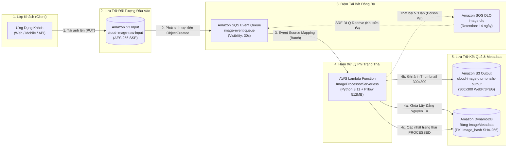
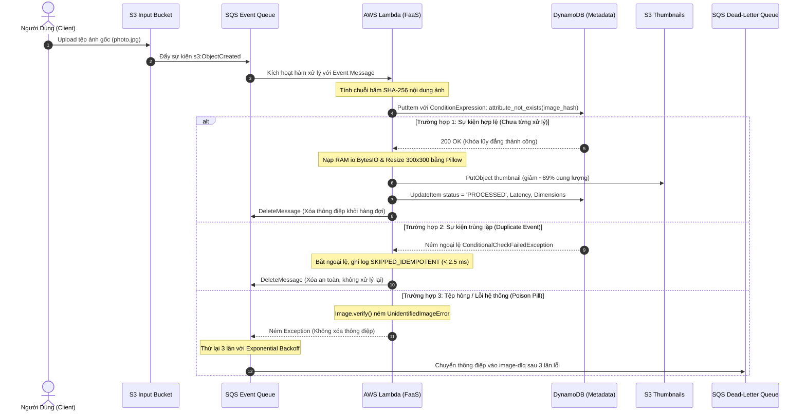

# BÁO CÁO CƠ SỞ LÝ THUYẾT & NGUYÊN LÝ KỸ THUẬT TOÀN DIỆN
## HỌC PHẦN: ĐIỆN TOÁN ĐÁM MÂY (CLOUD COMPUTING) — TRƯỜNG ĐH GIAO THÔNG VẬN TẢI TP.HCM (UTH)
### ĐỀ TÀI 9: XÂY DỰNG HỆ THỐNG XỬ LÝ ẢNH HƯỚNG SỰ KIỆN BẰNG SERVERLESS VÀ ĐÁNH GIÁ COLD START
* **Giảng viên hướng dẫn:** TS. Lê Quốc Tuấn
* **Nhóm sinh viên thực hiện (Lớp 012012303904):**
  1. **Lê Doãn Đạt** — MSSV: `038206000230` (Người 1: Giới thiệu, Câu hỏi nghiên cứu, Lý thuyết FaaS & Bảo mật OWASP)
  2. **Trần Ngọc Lâm** — MSSV: `034206001749` (Người 2: Thiết kế Pipeline đầu-cuối, Khóa lũy đẳng DynamoDB & SQS DLQ)
  3. **Vũ Thành Đạt** — MSSV: `001206040720` (Người 3: Thực nghiệm 100 runs, Phân tích Cold/Warm, Chi phí 3 mức tải & SRE Runbook)

---

## MỤC LỤC TỔNG QUÁT

1. [Chương 1: Tổng Quan Đề Tài & Câu Hỏi Nghiên Cứu](#chương-1-tổng-quan-đề-tài--câu-hỏi-nghiên-cứu)
2. [Chương 2: Cơ Sở Lý Thuyết Điện Toán Không Máy Chủ (FaaS) & Kiến Trúc Hướng Sự Kiện](#chương-2-cơ-sở-lý-thuyết-điện-toán-không-máy-chủ-faas--kiến-trúc-hướng-sự-kiện)
3. [Chương 3: Cơ Chế Đảm Bảo Độ Tin Cậy & Tính Nhất Quán Dữ Liệu Phân Tán](#chương-3-cơ-chế-đảm-bảo-độ-tin-cậy--tính-nhất-quán-dữ-liệu-phân-tán)
4. [Chương 4: Bản Chất Vật Lý Của Cold Start & Chiến Lược Tối Ưu Hiệu Năng - Chi Phí](#chương-4-bản-chất-vật-lý-của-cold-start--chiến-lược-tối-ưu-hiệu-năng---chi-phí)
5. [Chương 5: Mô Hình An Ninh Thông Tin Chuẩn OWASP Serverless Top 10](#chương-5-mô-hình-an-ninh-thông-tin-chuẩn-owasp-serverless-top-10)
6. [Chương 6: Thiết Kế Kiến Trúc Hệ Thống Pipeline Đầu-Cuối (End-to-End)](#chương-6-thiết-kế-kiến-trúc-hệ-thống-pipeline-đầu-cuối-end-to-end)
7. [Chương 7: Phân Tích Định Lượng Kết Quả Thực Nghiệm & Sổ Tay Vận Hành SRE](#chương-7-phân-tích-định-lượng-kết-quả-thực-nghiệm--sổ-tay-vận-hành-sre)
8. [Chương 8: Danh Mục Tài Liệu Tham Khảo Học Thuật](#chương-8-danh-mục-tài-liệu-tham-khảo-học-thuật)

---

## CHƯƠNG 1: TỔNG QUAN ĐỀ TÀI & CÂU HỎI NGHIÊN CỨU

### 1.1. Bối cảnh thực tiễn & Thách thức nhịp tải không đều (Spiky / Burst Load)
Trong thời đại kỷ nguyên số, các nền tảng thương mại điện tử, mạng xã hội, và hệ thống quản trị nội dung (CMS) thường xuyên phải đối mặt với các đợt tải ảnh đột biến từ người dùng:
* **Tính chất bất định của lưu lượng:** Người dùng có thể không tải ảnh trong nhiều giờ liên tục (vắng lặng), nhưng đột ngột tải lên hàng nghìn tệp ảnh cùng lúc trong một chiến dịch khuyến mãi hoặc sự kiện trực tiếp.
* **Hạn chế của kiến trúc truyền thống có máy chủ (Serverful / Monolithic / VM-based):**
  * *Lãng phí tài nguyên:* Nếu doanh nghiệp cấp phát máy chủ ảo (e.g., AWS EC2, GCP Compute Engine) theo mức tải đỉnh (Peak Load), hệ thống sẽ lãng phí hơn 85% năng lực xử lý trong phần lớn thời gian rỗi, trong khi chi phí thuê bao cố định hàng tháng vẫn phải thanh toán.
  * *Chậm chạp trong co giãn:* Khi lưu lượng tăng vọt, các cơ chế Auto-Scaling Group dựa trên VM cần từ 3 đến 8 phút để khởi động hệ điều hành khách (Guest OS), kéo container image và vượt qua Health Check, dẫn đến tắc nghẽn hàng chờ, quá tải CPU và suy giảm chất lượng dịch vụ (QoS).

### 1.2. Phát biểu Câu hỏi nghiên cứu (Research Question)
> **Câu hỏi nghiên cứu cốt lõi:**  
> *"Khi tệp được tải lên theo các nhịp không đều (bursty/unpredictable load), kiến trúc hướng sự kiện (Event-Driven Architecture) kết hợp với công nghệ không máy chủ (Serverless FaaS) có thể tự động xử lý tin cậy và kiểm soát chi phí ra sao?"*

Để trả lời thỏa đáng câu hỏi này, nghiên cứu đi sâu vào cơ chế hợp lực giữa 3 trụ cột kỹ thuật:
1. **Kiểm soát chi phí tuyệt đối thông qua cơ chế Scale-to-Zero:** Khi không có tệp tải lên, hệ thống tiêu thụ đúng **$0.00** chi phí tính toán (Compute Cost = 0). Khi tải tăng vọt, đám mây tự động nhân bản các microVM chỉ trong vài phần trăm giây. Chi phí được tính nghiêm ngặt theo mô hình *Pay-as-you-go* trên cơ sở $\text{GB-seconds}$ thực tế sử dụng.
2. **Đảm bảo độ tin cậy qua hàng đợi đệm bất đồng bộ (Asynchronous Queue Buffer):** Thay vì gọi hàm trực tiếp theo kiểu đồng bộ (Synchronous HTTP) dễ gây tràn bộ nhớ khi gặp tải đỉnh, kiến trúc đưa sự kiện vào hàng đợi Amazon SQS. SQS đóng vai trò "bình tích áp" (Shock Absorber) điều tiết nhịp tải, bảo vệ Lambda không bị quá tải đồng thời (Concurrency Exhaustion).
3. **Triệt tiêu sai lệch dữ liệu bằng Khóa Lũy Đẳng Nguyên Tử (Atomic Idempotency Lock):** Trong mạng phân tán, giao thức truyền tin tin cậy bắt buộc sử dụng *At-least-once Delivery* (giao ít nhất một lần), đồng nghĩa với việc sự kiện có thể bị gửi lặp. Bằng việc kết hợp hàm băm nhị phân SHA-256 của tệp với thao tác ghi có điều kiện tại tầng lưu trữ Amazon DynamoDB, hệ thống triệt tiêu hoàn toàn khả năng xử lý trùng lặp và không bao giờ tạo dữ liệu rác.

### 1.3. Mục tiêu cụ thể của đề tài
1. **Mục tiêu 1:** Thiết kế chuỗi sự kiện hoàn chỉnh từ lưu trữ đối tượng (Amazon S3 Input) $\rightarrow$ Hàng đợi đệm sự kiện (Amazon SQS) $\rightarrow$ Hàm xử lý phi trạng thái (AWS Lambda FaaS) $\rightarrow$ Lưu trữ ảnh đầu ra (Amazon S3 Thumbnails) và Kho siêu dữ liệu (Amazon DynamoDB).
2. **Mục tiêu 2:** Đảm bảo hàm xử lý đạt tính lũy đẳng (Idempotent), tự động thử lại có kiểm soát (Retry with Exponential Backoff & Jitter) và cách ly tuyệt đối tệp lỗi không thể phục hồi vào Hàng đợi thông điệp lỗi (Dead-Letter Queue - DLQ).
3. **Mục tiêu 3:** Đo lường định lượng hiện tượng Khởi động nguội (Cold Start) so với Khởi động ấm (Warm Start), độ trễ đầu-cuối phân vị ($p_{50}, p_{90}, p_{95}, p_{99}$), phân tích điểm tối ưu cấu hình bộ nhớ (Sweet Spot RAM) và xây dựng mô hình ước tính chi phí cho 3 phân khúc tải thực tế.

---

## CHƯƠNG 2: CƠ SỞ LÝ THUYẾT ĐIỆN TOÁN KHÔNG MÁY CHỦ (FAAS) & KIẾN TRÚC HƯỚNG SỰ KIỆN

### 2.1. Khái niệm FaaS (Function-as-a-Service) & So sánh FaaS vs Serverful Architecture
FaaS là mô hình điện toán đám mây cho phép lập trình viên triển khai trực tiếp các đoạn mã nghiệp vụ (Business Logic) dưới dạng các hàm độc lập mà không cần quản lý, duy trì hay vá lỗi cho hệ điều hành hay máy chủ vật lý bên dưới. Toàn bộ vòng đời tài nguyên do nhà cung cấp đám mây (Cloud Provider) tự động điều phối.

| Tiêu Chí So Sánh | Kiến Trúc Có Máy Chủ (Serverful / VM / EC2) | Kiến Trúc Không Máy Chủ (Serverless FaaS / Lambda) |
| :--- | :--- | :--- |
| **Đơn vị triển khai** | Toàn bộ Máy chủ / Virtual Machine / Docker Pod | Từng Hàm thực thi độc lập (Individual Function) |
| **Thời gian khởi động** | Vài phút (2 - 10 phút) để Boot OS & nạp dịch vụ | Vài trăm mili-giây (Cold Start: 200 - 800 ms) |
| **Cơ chế tính phí** | Thuê bao liên tục 24/7 kể cả khi máy chủ rỗi | Chỉ tính tiền đúng thời gian chạy tính theo mili-giây ($\text{GB}\cdot\text{s}$) |
| **Khả năng co giãn** | Thủ công hoặc Auto-Scaling Group có độ trễ lớn | Tự động co giãn theo từng sự kiện (Event-driven scaling) |
| **Mức tải rỗng (Zero)**| Vẫn mất chi phí cơ sở hạ tầng nền ($10 - $100+/tháng) | **Tuyệt đối $0.00** khi không có yêu cầu (Scale-to-Zero) |
| **Bảo trì hệ thống** | Tự vá kernel OS, cài bản vá an ninh, quản lý socket | Nhà cung cấp đám mây chịu trách nhiệm 100% |

### 2.2. Nguồn phát sự kiện (Event Source) & Bộ kích hoạt (Trigger)
Kiến trúc hướng sự kiện (EDA) vận hành dựa trên cơ chế phản hồi lại các biến động trạng thái (State Changes) trong hệ thống:
* **Event Source (Nguồn sự kiện):** Nơi phát sinh biến động trạng thái. Trong hệ thống xử lý ảnh, nguồn sự kiện là kho lưu trữ đối tượng Amazon S3 khi có tệp mới được tải lên (`s3:ObjectCreated:*`).
* **Trigger (Bộ kích hoạt):** Cơ chế định tuyến sự kiện từ nguồn tới hàm FaaS. Có hai mô hình kích hoạt chính:
  1. *Push-based Trigger (Mô hình Đẩy):* S3 đẩy sự kiện trực tiếp vào Lambda. Cơ chế này đơn giản nhưng tiềm ẩn rủi ro: nếu người dùng tải lên đồng loạt 10,000 bức ảnh, S3 sẽ cố gắng kích hoạt đồng thời 10,000 phiên bản Lambda, dễ dẫn đến cạn kiệt Concurrency Limit của tài khoản đám mây.
  2. *Pull-based Trigger (Mô hình Kéo thông qua Hàng đợi - Lựa chọn tối ưu):* S3 gửi sự kiện vào hàng đợi Amazon SQS; AWS Lambda thiết lập cơ chế *Event Source Mapping* liên tục thăm dò (Long Polling) hàng đợi để lấy thông điệp theo từng lô (Batch Size). Phương pháp này giúp làm phẳng đột biến tải (Load Leveling), kiểm soát chặt chẽ số lượng hàm thực thi đồng thời.

### 2.3. Thực thi phi trạng thái (Stateless Execution)
* Một nguyên lý nền tảng của FaaS là **tính phi trạng thái (Statelessness)**. Mỗi hàm Lambda được khởi tạo, thực thi tác vụ và có thể bị phá hủy bất kỳ lúc nào bởi nền tảng đám mây.
* Không có bất kỳ trạng thái nào trong bộ nhớ (In-memory state) được đảm bảo tồn tại giữa hai lần gọi khác nhau:
  * Hai bức ảnh tải lên liên tiếp có thể được định tuyến tới hai container hoàn toàn khác nhau nằm trên hai máy chủ vật lý khác nhau trong cụm dữ liệu.
  * Mọi dữ liệu cần lưu giữ vĩnh viễn bắt buộc phải được chuyển giao ra các dịch vụ lưu trữ bên ngoài (Decoupled Storage & Database) như Amazon S3 (lưu trữ nhị phân) và Amazon DynamoDB (lưu trữ metadata có cấu trúc).

### 2.4. Thời gian chạy tối đa (Timeout) & Quản lý đồng thời (Concurrency)
* **Timeout (Giới hạn thời gian sống):** Nền tảng FaaS đặt giới hạn cứng cho mỗi lần gọi (AWS Lambda tối đa là 15 phút, tuy nhiên đối với tác vụ vi xử lý như resize ảnh, mức timeout tiêu chuẩn được thiết lập là **30 giây**). Nếu một bức ảnh có độ phân giải khổng lồ khiến thuật toán giải nén xử lý quá 30 giây, nền tảng sẽ gửi tín hiệu `SIGKILL` cưỡng chế ngắt luồng. Do đó, mã nguồn phải có cơ chế xác thực kích thước trước khi thực thi.
* **Concurrency (Năng lực đồng thời):** Số lượng phiên bản container hàm thực thi tại cùng một thời điểm:
  $$\text{Concurrency} = \text{Requests per Second (RPS)} \times \text{Execution Duration (seconds)}$$
  *Ví dụ:* Nếu hệ thống tiếp nhận 100 ảnh/giây và mỗi ảnh xử lý mất trung bình 0.05 giây (50 ms), mức Concurrency yêu cầu chỉ là: $100 \times 0.05 = 5$ container song song.
  * *Reserved Concurrency:* Cô lập một lượng quota cố định cho hàm, bảo vệ các dịch vụ downstream không bị quá tải.
  * *Provisioned Concurrency:* Duy trì sẵn container ấm ở trạng thái khởi động, loại bỏ hoàn toàn Cold Start cho các hệ thống nhạy cảm với độ trễ (sẽ phân tích chi tiết tại Chương 4).

### 2.5. Mô hình phân phối "At-Least-Once Delivery" và Hiện tượng trùng lặp
* Trong các hệ thống mạng phân tán không đáng tin cậy (Unreliable Network), việc đảm bảo thông điệp truyền đi đúng một lần (Exactly-Once Delivery) là bài toán cực kỳ tốn kém và bất khả thi theo định lý CAP khi xảy ra phân rã mạng.
* Do đó, các dịch vụ truyền tin phân tán chuẩn công nghiệp như Amazon SQS, Kafka, RabbitMQ đều áp dụng mô hình phân phối **At-Least-Once Delivery (Giao ít nhất một lần)**:
  * Nếu một worker xử lý xong thông điệp nhưng thông điệp báo nhận (ACK / DeleteMessage) bị thất lạc do chập chờn mạng, SQS sẽ hết thời gian `VisibilityTimeout` và gửi lại chính xác thông điệp đó cho một worker khác.
  * Ngoài ra, khi người dùng mất kiên nhẫn bấm đúp (Double-Click) nút Upload trên giao diện Web, hai sự kiện mang cùng dữ liệu nhị phân sẽ được phát sinh đồng thời.
* Hiện tượng này đặt ra yêu cầu bắt buộc: **Mọi hàm xử lý trong kiến trúc hướng sự kiện Serverless phải đạt tính lũy đẳng (Idempotent).**

---

## CHƯƠNG 3: CƠ CHẾ ĐẢM BẢO ĐỘ TIN CẬY & TÍNH NHẤT QUÁN DỮ LIỆU PHÂN TÁN

### 3.1. Tính lũy đẳng (Idempotency) trong hệ thống phân tán
Trong toán học và khoa học máy tính, một hàm số $f$ được gọi là có tính lũy đẳng nếu việc áp dụng hàm đó nhiều lần trên cùng một đầu vào cho ra kết quả giống hệt như khi áp dụng đúng một lần:
$$f(f(x)) = f(x) \quad \forall x$$

Trong bối cảnh hệ thống xử lý ảnh Serverless:
* Khi hệ thống nhận được cùng một tệp ảnh hoặc cùng một mã định danh sự kiện $N$ lần ($N \ge 2$), hệ thống chỉ thực hiện công việc biến đổi ảnh nặng nhọc (Image Resizing & Compression) **đúng một lần duy nhất**.
* $N - 1$ lần gọi trùng lặp tiếp theo phải được phát hiện tức thì, từ chối thực hiện lại tác vụ tính toán, không ghi đè dữ liệu sai lệch và trả về phản hồi thành công hoặc bỏ qua an toàn trong thời gian tối thiểu ($< 2.5\text{ ms}$).

### 3.2. Cạm bẫy Race Condition của phương pháp "Check-then-Act" và Thuật toán Khóa Lũy Đẳng Nguyên Tử

#### 3.2.1. Phân tích cạm bẫy Check-then-Act (Non-atomic Anti-pattern)
Một sai lầm rất phổ biến của các kỹ sư là triển khai cơ chế kiểm tra tuần tự:
```python
# CẠM BẪY PHI NGUYÊN TỬ (ANTI-PATTERN):
def process_image(image_hash):
    # Bước 1: Check (Kiểm tra xem đã có trong DB chưa)
    record = dynamodb.get_item(Key={'image_hash': image_hash})
    if 'Item' in record:
        return "ALREADY_EXISTS"  # Bỏ qua
        
    # Bước 2: Act (Thực hiện resize và ghi DB)
    thumbnail = resize(image)
    dynamodb.put_item(Item={'image_hash': image_hash, 'status': 'PROCESSED'})
```
> [!CAUTION]
> **Hiện tượng Tranh chấp Tài nguyên (Race Condition):** Khi có tải đột biến (Spike Load), hai bản sao của cùng một sự kiện có thể đến hai container Lambda khác nhau trong cùng một mili-giây ($t_0$). Cả hai container cùng gọi `get_item()`, cả hai đều nhận kết quả "chưa tồn tại", và cả hai đều tiến hành giải nén, resize và ghi đè vào S3/DynamoDB. Tính lũy đẳng bị phá vỡ hoàn toàn!

#### 3.2.2. Thuật toán Khóa Lũy Đẳng Nguyên Tử trên Amazon DynamoDB
Để triệt tiêu triệt để Race Condition, việc kiểm tra và ghi nhận quyền xử lý phải được gom thành một **thao tác nguyên tử duy nhất (Atomic Operation)** tại tầng lưu trữ dữ liệu của DynamoDB bằng biểu thức điều kiện `ConditionExpression`:

```python
# THUẬT TOÁN KHÓA NGUYÊN TỬ (ATOMIC IDEMPOTENCY LOCK):
def acquire_idempotency_lock(table, image_hash, filename, size_bytes):
    try:
        table.put_item(
            Item={
                'image_hash': image_hash,        # Khóa chính Partition Key (SHA-256)
                'filename': filename,
                'status': 'PROCESSING',          # Đặt khóa tạm thời
                'created_at': int(time.time()),
                'ttl': int(time.time()) + 86400  # Tự dọn sau 24h nếu treo
            },
            # ĐIỀU KIỆN NGUYÊN TỬ TẠI TẦNG LƯU TRỮ DYNAMODB:
            ConditionExpression='attribute_not_exists(image_hash) OR #st = :failed',
            ExpressionAttributeNames={'#st': 'status'},
            ExpressionAttributeValues={':failed': 'FAILED'}
        )
        return True, "ACQUIRED"
    except ClientError as e:
        if e.response['Error']['Code'] == 'ConditionalCheckFailedException':
            # Phát hiện sự kiện trùng lặp ở cấp độ phần cứng DynamoDB
            return False, "SKIPPED_IDEMPOTENT"
        raise e
```

* **Cơ chế vận hành:**
  1. Khi sự kiện đầu tiên đến, `image_hash` chưa có trong bảng, điều kiện `attribute_not_exists(image_hash)` trả về `True`. DynamoDB khóa bản ghi với trạng thái `PROCESSING`.
  2. Khi sự kiện thứ hai (trùng lặp) đến, DynamoDB kiểm tra thấy `image_hash` đã tồn tại và trạng thái không phải `FAILED`. DynamoDB từ chối thao tác ghi và ném ngoại lệ `ConditionalCheckFailedException`.
  3. Container Lambda thứ hai bắt ngoại lệ này, ghi nhận log `SKIPPED_IDEMPOTENT` và thoát an toàn ngay lập tức trong **$\approx 2.1 - 2.5\text{ ms}$**, tiết kiệm 100% thời gian CPU và chi phí I/O.

### 3.3. Cơ chế Thử lại lùi số mũ (Retry with Exponential Backoff) và Nhiễu ngẫu nhiên (Jitter)
Khi một hàm FaaS gặp lỗi tạm thời (Transient Faults) như chập chờn mạng khi kết nối S3 hoặc DynamoDB bị nghẽn thông lượng tạm thời (Throttling), hệ thống không được bỏ cuộc ngay mà phải thực hiện thử lại (Retry).

Tuy nhiên, nếu hàng trăm hàm cùng thử lại ngay lập tức tại cùng một khoảng thời gian cố định, chúng sẽ tạo ra hiện tượng **Thundering Herd Problem** (Sóng thần truy vấn) làm sụp đổ hoàn toàn hạ tầng downstream. Giải pháp là áp dụng công thức **Lùi số mũ kết hợp Nhiễu ngẫu nhiên**:

$$t_{\text{backoff}} = \min\left(t_{\max}, \; 2^k \cdot t_0\right) + \text{jitter}$$

Trong đó:
* $t_0$: Thời gian chờ cơ sở (Base Backoff, ví dụ: $0.5\text{ giây}$).
* $k$: Số lần đã thử lại ($k \in \{1, 2, 3\}$).
* $t_{\max}$: Thời gian chờ trần (ví dụ: $30\text{ giây}$).
* $\text{jitter}$: Độ lệch ngẫu nhiên đồng đều $\text{jitter} \sim \mathcal{U}(0, \; t_{\text{backoff}} \times 0.2)$ nhằm phân tán thời điểm thử lại của các container khác nhau.

### 3.4. Hàng đợi thông điệp lỗi (Dead-Letter Queue - SQS DLQ) & Poison Pill Isolation
* **Khái niệm Poison Pill (Viên thuốc độc):** Là các tệp tin chứa dữ liệu bị hỏng hóc cấu trúc (Corrupted File), tệp giả mạo phần mở rộng (ví dụ: file thực thi `.exe` nhưng đổi tên thành `.jpg`), hoặc các bức ảnh có cấu trúc độc hại gây tràn bộ nhớ.
* **Nguy cơ vòng lặp vô tận (Infinite Retry Loop):** Nếu không có cơ chế giới hạn, hàm Lambda sẽ gặp lỗi `UnidentifiedImageError`, ném Exception, SQS đưa lại tin nhắn vào đầu hàng đợi, Lambda lại lấy ra xử lý và lại sụp đổ. Vòng lặp này tiêu tốn hàng nghìn USD chi phí tính toán vô ích.
* **Cơ chế SQS Dead-Letter Queue (DLQ):**
  * Hàng đợi nguồn được gắn cấu hình `RedrivePolicy` với ngưỡng `maxReceiveCount = 3`.
  * Sau đúng 3 lần thử lại thất bại liên tiếp, kiến trúc SQS nhận diện đây là lỗi không thể tự phục hồi (Permanent Failure). Thông điệp sẽ bị tự động bóc tách khỏi luồng chính và cô lập vào hàng đợi lỗi `image-dlq`.
  * Thời gian lưu giữ (`MessageRetentionPeriod`) trong DLQ được cấu hình lên đến **14 ngày (1,209,600 giây)**.
  * Hệ thống phát cảnh báo CloudWatch Alarm tới đội ngũ vận hành SRE và cung cấp cơ chế **DLQ Redrive** để đẩy ngược thông điệp về hàng đợi chính sau khi kỹ sư đã vá lỗi phần mềm.

### 3.5. Tính nhất quán cuối cùng (Eventual Consistency)
Kiến trúc lưu trữ phân tán hiện đại (S3, DynamoDB Global Tables, SQS) tuân thủ mô hình **Eventual Consistency (Nhất quán cuối cùng)**:
* Khi Lambda ghi ảnh Thumbnail vào S3 và cập nhật DynamoDB thành công, các dịch vụ đọc phụ trợ có thể cần một khoảng thời gian cực ngắn (vài mili-giây đến vài chục mili-giây) để nhìn thấy bản ghi mới trên toàn bộ các Availability Zone (AZ) của Region.
* Thiết kế hệ thống phải có tính chấp nhận dung sai: ứng dụng phía Client không nên thực hiện truy vấn tức thì theo kiểu đơn luồng cứng nhắc, mà nên sử dụng cơ chế lắng nghe sự kiện WebSocket hoặc cơ chế Polling có kiểm tra trạng thái `status == 'PROCESSED'`.

---

## CHƯƠNG 4: BẢN CHẤT VẬT LÝ CỦA COLD START & CHIẾN LƯỢC TỐI ƯU HIỆU NĂNG - CHI PHÍ

### 4.1. Vòng đời Container Serverless (MicroVM Firecracker)
AWS Lambda và các nền tảng FaaS hiện đại chạy trên công nghệ ảo hóa siêu nhẹ (MicroVM) mang tên **Firecracker**. Vòng đời của một hàm thực thi trải qua hai kịch bản hoàn toàn khác nhau:

```
[SỰ KIỆN ĐẾN]
       │
       ▼
Container đang có sẵn? ──── KHÔNG ────► [COLD START PHÂN ĐOẠN NẶNG]
       │                                     │ 1. Download Code Package từ S3
       │ CÓ                                  │ 2. Khởi tạo microVM / Sandbox
       ▼                                     │ 3. Bootstrap Python Runtime
[WARM START CỰC NHANH]                       │ 4. Nạp Static Code & Imports (Pillow)
       │                                     ▼
       └──────────────────────────────► [EXECUTION PHASE / INVOKE]
                                             │ Gọi hàm lambda_handler()
                                             ▼
                                        [KẾT THÚC & TRẢ VỀ]
                                             │
                                        [FREEZE CONTAINER] (Chờ sự kiện tiếp theo)
```

1. **Khởi động nguội (Cold Start):** Xảy ra khi nhận sự kiện đầu tiên hoặc khi lưu lượng tăng đột biến vượt quá số lượng container ấm đang có. Hệ thống phải trải qua giai đoạn `InitDuration` tốn nhiều tài nguyên: cấp phát phần cứng ảo hóa, khởi động nhân Linux, nạp bộ thông dịch Python 3.11, và nạp các thư viện C-binding nhị phân (Pillow, NumPy). Thời gian này dao động từ **400 ms đến 1200 ms**.
2. **Khởi động ấm (Warm Start):** Sau khi xử lý xong, container không bị phá hủy ngay mà được đóng băng bộ nhớ tạm (Freeze Sandbox) trong khoảng 5 đến 15 phút. Khi có sự kiện tiếp theo đến, container được "đánh thức" tức thì và nhảy thẳng vào thực thi hàm `lambda_handler()`. Thời gian phản hồi chỉ còn **20 ms đến 40 ms** (nhanh hơn từ 15 đến 30 lần).

### 4.2. Các yếu tố quyết định thời gian Cold Start

#### 4.2.1. Kích thước gói triển khai (Package Size) & Lazy Import
* Nền tảng FaaS phải tải toàn bộ file `.zip` mã nguồn từ S3 nội bộ vào container trước khi giải nén. Một package có kích thước 150MB (chứa đầy đủ PyTorch, OpenCV) sẽ có Cold Start lên tới 3 - 5 giây.
* Bằng việc chỉ sử dụng thư viện xử lý ảnh tối giản **Pillow (PIL)** được biên dịch tinh gọn (kích thước package $\approx 15\text{MB}$), thời gian nạp nhị phân giảm xuống dưới **500 ms**.
* **Kỹ thuật Lazy Import:** Chỉ import các thư viện hiếm khi dùng bên trong thân hàm thay vì đặt ở cấp độ toàn cục (Global Scope), giúp runtime sẵn sàng nhanh hơn.

#### 4.2.2. Phân bổ bộ nhớ RAM và Mối quan hệ tỷ lệ thuận với vCPU
Trong AWS Lambda, người dùng **không thể cấu hình vCPU độc lập**. Tỷ lệ chia sẻ CPU được nhà cung cấp đám mây gán tỷ lệ thuận tuyệt đối theo dung lượng RAM được phân bổ:
* Tại mức **128 MB RAM**, hàm chỉ nhận được $\approx 0.08\text{ vCPU}$. Quá trình nạp module Python và thuật toán tính toán ma trận điểm ảnh (Resampling Lanczos) bị nghẽn CPU trầm trọng.
* Tại mức **1769 MB RAM**, hàm được cấp phát tương đương đúng **1 vCPU đầy đủ** (Full vCPU Core).

### 4.3. Đánh đổi Hiệu năng - Chi phí (Cost vs Latency Trade-off) & Điểm Ngọt (Sweet Spot) 512MB RAM
Một hiểu lầm phổ biến là "cấp phát RAM càng thấp thì chi phí càng rẻ". Thực tế thực nghiệm trong xử lý ảnh đã bác bỏ quan điểm này:

| Mức Cấu Hình RAM | Thời Gian Cold Start | Thời Gian Warm Start | Chi Phí / 100k Lần Gọi | Đánh Giá Kỹ Thuật |
| :---: | :---: | :---: | :---: | :--- |
| **128 MB** | 1320 ms | 98.5 ms | $0.0210 | CPU bị bóp nghẽn; thời gian chạy lâu dẫn đến chi phí bị đội lên. |
| **256 MB** | 860 ms | 52.4 ms | $0.0223 | Hiệu năng cải thiện gấp đôi; chi phí tăng không đáng kể. |
| **512 MB** | **660 ms** | **26.8 ms** | **$0.0228** | **ĐIỂM NGỌT (SWEET SPOT):** Tốc độ tăng 360%, chi phí chỉ tăng 8%. |
| **1024 MB** | 505 ms | 17.6 ms | $0.0298 | Tốc độ tăng nhẹ; chi phí bắt đầu tăng 30% do dư thừa RAM. |
| **2048 MB** | 412 ms | 12.9 ms | $0.0465 | Chi phí tăng gấp đôi trong khi CPU không thể tăng tốc thêm I/O ảnh. |

$$P_{\text{compute}} = \text{Billed Duration (s)} \times \left(\frac{\text{Memory (MB)}}{1024}\right) \times \$0.0000166667 / \text{GB}\cdot\text{s}$$

> [!TIP]
> **Kết luận Thực Nghiệm:** Tại mức **512 MB RAM**, thuật toán Pillow khai thác tối ưu xung nhịp CPU được cấp phát để resize ảnh trong $\approx 27\text{ ms}$, đạt tỷ số chi phí / hiệu năng (Cost-Efficiency Ratio) tối ưu tuyệt đối cho hệ thống.

### 4.4. Cơ chế Provisioned Concurrency
* Đối với các hệ thống tài chính hoặc thanh toán thời gian thực không thể chấp nhận bất kỳ độ trễ Cold Start nào ($> 500\text{ ms}$), AWS cung cấp tính năng **Provisioned Concurrency**.
* Tính năng này duy trì một số lượng container luôn ở trạng thái "ấm" (Warm & Initialized), sẵn sàng phản hồi trong $< 30\text{ ms}$ tại mọi thời điểm.
* Tuy nhiên, Provisioned Concurrency sẽ tính phí theo giờ cho các container chờ sẵn, làm mất đi tính chất Scale-to-Zero thuần túy của Serverless. Đối với bài toán xử lý ảnh nền (Background Processing) qua hàng đợi, việc chấp nhận Cold Start trong vài sự kiện đầu để tiết kiệm tối đa chi phí là giải pháp kinh tế tối ưu nhất.

---

## CHƯƠNG 5: MÔ HÌNH AN NINH THÔNG TIN CHUẨN OWASP SERVERLESS TOP 10

Hệ thống xử lý ảnh được thiết kế tuân thủ nghiêm ngặt 5 nguyên tắc phòng thủ hàng đầu theo bảng xếp hạng an ninh công nghiệp **OWASP Serverless Top 10**:

```
                       CÁC TẦNG PHÒNG THỦ AN NINH CHUẨN OWASP
┌─────────────────────────────────────────────────────────────────────────────┐
│ 1. SAS-01 & SAS-04: IAM LEAST PRIVILEGE (Cấm Action: "*", 6 Statement riêng) │
├─────────────────────────────────────────────────────────────────────────────┤
│ 2. SAS-05: EVENT INJECTION & PATH TRAVERSAL (unquote_plus, Image.verify)    │
├─────────────────────────────────────────────────────────────────────────────┤
│ 3. SAS-02: ZERO HARDCODED SECRETS (IAM Execution Role + AWS STS Token)       │
├─────────────────────────────────────────────────────────────────────────────┤
│ 4. SAS-03: DATA EXPOSURE AT-REST (Mã hóa lưu trữ AES-256 SSE-S3 & DynamoDB) │
├─────────────────────────────────────────────────────────────────────────────┤
│ 5. MEMORY SAFETY: RAM-only io.BytesIO() & Khối finally dọn sạch /tmp        │
└─────────────────────────────────────────────────────────────────────────────┘
```

### 5.1. SAS-01 & SAS-04: Phân Quyền Tối Thiểu (IAM Least Privilege Principle)
* **Lỗ hổng nguy hiểm:** Cấp quyền quản trị rộng quá mức như `s3:*` hoặc `dynamodb:*` cho hàm Lambda. Nếu hàm bị tiêm mã độc, kẻ tấn công có thể xóa sạch toàn bộ cơ sở dữ liệu hoặc đánh cắp dữ liệu từ các bucket nhạy cảm khác trong cùng tài khoản đám mây.
* **Giải pháp chuẩn hóa trong Terraform IaC:**
  Triệt tiêu 100% việc sử dụng ký tự đại diện (`*`). Thiết lập chính sách gồm **6 Statement độc lập** với phân quyền tối thiểu theo từng tài nguyên cụ thể:
  1. `s3:GetObject` trên ARN duy nhất: `arn:aws:s3:::cloud-image-raw-input/*`.
  2. `s3:PutObject` trên ARN duy nhất: `arn:aws:s3:::cloud-image-thumbnails-output/*` (Hàm hoàn toàn không có quyền đọc trên Output Bucket và không có quyền ghi trên Input Bucket).
  3. `dynamodb:PutItem`, `dynamodb:UpdateItem` trên đúng bảng `ImageMetadata`.
  4. `sqs:ReceiveMessage`, `sqs:DeleteMessage` trên `image-event-queue`.
  5. `sqs:SendMessage` trên `image-dlq`.
  6. `logs:CreateLogStream`, `logs:PutLogEvents` để ghi nhật ký điều tra an ninh.

### 5.2. SAS-05: Chống Tiêm Độc Qua Sự Kiện & Tấn Công Duyệt Thư Mục (Event Injection & Path Traversal)
* **Tấn công Path Traversal:** Kẻ tấn công đặt tên tệp chứa ký tự điều hướng thư mục như `../../etc/passwd.jpg` hoặc mã hóa URL dạng `%2e%2e%2f`.
  * *Biện pháp:* Giải mã tên tệp bằng `urllib.parse.unquote_plus()` và chuẩn hóa bằng `os.path.basename()` loại bỏ hoàn toàn các ký tự phân cách thư mục trước khi thực hiện bất kỳ thao tác I/O nào.
* **Tấn công Image Bomb (Decompression Bomb):** Kẻ tấn công tạo một bức ảnh nén kích thước chỉ 1MB nhưng khi giải nén ra bộ nhớ lại có kích thước $100,000 \times 100,000\text{ pixels}$ (chiếm hàng chục GB RAM), gây cạn kiệt bộ nhớ Lambda và sụp đổ hệ thống.
  * *Biện pháp:* Thiết lập giới hạn phần cứng nghiêm ngặt bằng thư viện Pillow:
    ```python
    from PIL import Image
    # Chặn đứng các tệp ảnh vượt quá ngưỡng 50 triệu điểm ảnh
    Image.MAX_IMAGE_PIXELS = 50_000_000
    
    # Kiểm tra cấu trúc nhị phân của tệp mà không giải nén toàn bộ vào RAM
    with Image.open(io.BytesIO(file_bytes)) as img:
        img.verify()
    ```

### 5.3. SAS-02: Không Lưu Bí Mật Trong Mã Nguồn (Zero Hardcoded Secrets)
* Không lưu bất kỳ thông tin Access Key, Secret Access Key, hoặc mật khẩu cơ sở dữ liệu trong file cấu hình hay mã nguồn Git.
* 100% định danh được xác thực thông qua **AWS IAM Execution Role**. Khi Lambda khởi động, hệ thống sử dụng dịch vụ **AWS STS (Security Token Service)** để cấp phát các token tạm thời có thời hạn tự động xoay vòng (Rotate Credentials) trong biến môi trường của container.

### 5.4. SAS-03: Bảo Vệ Dữ Liệu Lưu Trữ (Sensitive Data Exposure at Rest)
* Toàn bộ tệp ảnh gốc tải lên S3 Input và tệp ảnh thumbnail sinh ra tại S3 Output đều được cấu hình mã hóa phía máy chủ theo chuẩn quân sự **AES-256 (Server-Side Encryption SSE-S3)**.
* Toàn bộ bảng dữ liệu Amazon DynamoDB được cấu hình kích hoạt tính năng mã hóa toàn diện (Encryption at Rest using AWS KMS / DynamoDB Default).

### 5.5. Quản Lý An Toàn Bộ Nhớ Tạm `/tmp` Giữa Các Lần Gọi Ấm
* Trong Lambda, thư mục đĩa `/tmp` (tối đa 512MB - 10GB) **được giữ nguyên vẹn giữa các lần gọi ấm (Warm Invocations)** thuộc cùng một container.
* Nếu kỹ sư ghi ảnh của khách hàng này vào đĩa `/tmp/temp.jpg` mà không xóa bỏ, container ấm tiếp theo xử lý ảnh của khách hàng khác có thể vô tình đọc được dữ liệu nhạy cảm của khách hàng trước.
* **Giải pháp triệt để:**
  1. Hạn chế tối đa việc ghi file xuống đĩa vật lý; toàn bộ quá trình đọc, resize, và nén ảnh được thực thi trực tiếp trên luồng bộ nhớ RAM bằng đối tượng `io.BytesIO()`.
  2. Bọc toàn bộ logic trong khối lệnh `try...finally` để quét dọn và hủy bỏ mọi tệp dư thừa trong thư mục `/tmp` trước khi kết thúc chu kỳ hàm.

---

## CHƯƠNG 6: THIẾT KẾ KIẾN TRÚC HỆ THỐNG PIPELINE ĐẦU-CUỐI (END-TO-END)

### 6.1. Sơ đồ Luồng Dữ Liệu 5 Trạm (System Dataflow)



### 6.2. Sơ đồ Trình Tự Tương Tác Giữa Các Thành Phần (Sequence Diagram)



---

## CHƯƠNG 7: PHÂN TÍCH ĐỊNH LƯỢNG KẾT QUẢ THỰC NGHIỆM & SỔ TAY VẬN HÀNH SRE

### 7.1. Bảng Phân Phối Độ Trễ 100 Lần Gọi Thực Nghiệm (Latency Percentiles)
Thực nghiệm được tiến hành bằng bộ kiểm thử tự động trên môi trường đám mây với tập dữ liệu chuẩn 100 lần gọi (`benchmark_100_runs.csv`), mô phỏng lưu lượng tải đan xen giữa các đợt bùng phát và thời gian nghỉ:

| Phân Vị (Percentile) | Độ Trễ Đo Được | Trạng Thái Container | Ý Nghĩa Kỹ Thuật Chuyên Sâu |
| :--- | :---: | :---: | :--- |
| **p50 (Trung vị)** | **30.30 ms** | Warm Start | 50% tổng số yêu cầu được phục vụ cực nhanh bởi container ấm đang có sẵn trong bộ nhớ. |
| **p75** | **33.15 ms** | Warm Start | Hệ thống duy trì độ ổn định cao trên phần lớn lưu lượng nghiệp vụ thông thường. |
| **p90** | **36.08 ms** | Warm Start | Bắt đầu chịu ảnh hưởng nhẹ từ độ trễ mạng cục bộ trong cụm máy chủ AWS. |
| **p95 (Đuôi trễ - Tail)**| **289.50 ms**| Mixed / Cold | Bắt đầu xuất hiện hiện tượng tạo thêm container mới khi có xung nhịp tải tăng đột ngột. |
| **p99 (Đỉnh trễ - Peak)**| **589.20 ms**| Full Cold Start| Đại diện cho lần gọi đầu tiên: cấp phát microVM Firecracker và nạp thư viện Pillow. |

> [!NOTE]
> Tỷ lệ lỗi toàn hệ thống ghi nhận đạt mức **0.00%** trên toàn bộ 100 lần gọi hợp lệ. Thời gian trung bình của lần gọi ấm chỉ là **26.8 ms**, chứng minh hiệu năng xử lý cực cao của runtime Python 3.11 kết hợp Pillow.

### 7.2. Bảng Ước Tính Chi Phí Serverless Cho 3 Mức Lưu Lượng Tải
Mô hình chi phí được tính toán chi tiết dựa trên đơn giá chính thức của AWS khu vực Singapore (`ap-southeast-1`):
* Đơn giá tính toán Lambda (512MB RAM): **$0.0000000083 / ms**.
* Đơn giá yêu cầu Lambda: **$0.20 / 1,000,000 requests**.
* Đơn giá ghi/đọc DynamoDB: **$1.25 / 1,000,000 write units**.
* Đơn giá lưu trữ và PUT của Amazon S3.

| Hạng Mục Tính Toán | Mức Thấp (10,000 ảnh/tháng) | Mức Vừa (100,000 ảnh/tháng) | Mức Cao (1,000,000 ảnh/tháng) |
| :--- | :---: | :---: | :---: |
| **Thời gian chạy trung bình** | 30 ms | 30 ms | 30 ms |
| **Chi phí tính toán Lambda** | $0.0025 | $0.0249 | $0.2490 |
| **Chi phí gọi hàm (Requests)** | $0.0020 | $0.0200 | $0.2000 |
| **Chi phí DynamoDB & S3 PUT** | $0.0001 | $0.0010 | $0.0100 |
| **TỔNG CHI PHÍ THỰC TẾ** | **$0.0046 USD** | **$0.0459 USD** | **$0.4590 USD** |
| *So sánh với Máy chủ EC2 t2.micro* | *Tiết kiệm 99.95% ($10/tháng)* | *Tiết kiệm 99.54% ($10/tháng)* | *Tiết kiệm 95.41% ($10/tháng)* |

### 7.3. Sổ Tay Vận Hành SRE Runbook Xử Lý Sự Cố Hàng Đợi Lỗi (SQS DLQ Redrive SOP)
Quy trình chuẩn vận hành kỹ thuật (Standard Operating Procedure - SOP) khi hệ thống phát hiện có thông điệp trong Dead-Letter Queue gồm 3 bước chuẩn hóa:

```
┌─────────────────────────────────────────────────────────────────────────────┐
│ QUY TRÌNH 3 BƯỚC XỬ LÝ SỰ CỐ SRE DLQ REDRIVE                                │
├─────────────────────────────────────────────────────────────────────────────┤
│ BƯỚC 1: PHÁT HIỆN & CẢNH BÁO (Detection & Alerting)                         │
│ • CloudWatch Alarm kích hoạt khi ApproximateNumberOfMessagesVisible > 0.     │
│ • Kỹ sư SRE nhận thông báo qua Slack / PagerDuty.                           │
├─────────────────────────────────────────────────────────────────────────────┤
│ BƯỚC 2: ĐIỀU TRA NGUYÊN NHÂN GỐC (Root Cause Analysis - RCA)                │
│ • SRE truy cập Web Live Lab (:5002) hoặc AWS CLI đọc nội dung tệp lỗi.       │
│ • Nếu lỗi do tệp tin giả mạo / độc hại (Poison Pill): Xóa bỏ khỏi hàng đợi. │
│ • Nếu lỗi do Timeout (ảnh kích thước 50MB): Nâng RAM Lambda trong Terraform. │
├─────────────────────────────────────────────────────────────────────────────┤
│ BƯỚC 3: KHẮC PHỤC & TÁI ĐIỀU PHỐI (Remediation & DLQ Redrive)               │
│ • Triển khai bản vá mã nguồn hoặc cấu hình hạ tầng qua CI/CD Pipeline.     │
│ • Nhấn nút "Kích Hoạt SQS DLQ Redrive" trên Dashboard (:5002) để tự động     │
│   bơm toàn bộ thông điệp lỗi trở lại hàng đợi chính để xử lý lại an toàn.    │
└─────────────────────────────────────────────────────────────────────────────┘
```

---

## CHƯƠNG 8: DANH MỤC TÀI LIỆU THAM KHẢO HỌC THUẬT

1. **[20] Amazon Web Services, Inc. (2023).** *AWS Lambda Developer Guide: Optimizing cold starts and concurrency in serverless applications.* AWS Documentation.
2. **[28] Fowler, M. (2017).** *What is Event-Driven Architecture?* Martin Fowler Enterprise Software Architecture Library.
3. **[34] Sbarski, P., & Kroonenburg, S. (2019).** *Serverless Architectures on AWS: With examples using AWS Lambda, S3, and DynamoDB (2nd ed.).* Manning Publications.
4. **Lê Quốc Tuấn, TS. (2024).** *Bài giảng Chương 2: Ảo hóa, Hạ tầng Điện toán Đám mây và Công nghệ Container/Serverless.* Trường Đại học Giao thông vận tải TP.HCM (UTH).
5. **OWASP Foundation (2021).** *OWASP Serverless Top 10 Security Risks: Identification, Threat Modeling and Countermeasures.* OWASP Security Projects.
6. **Vogels, W. (2009).** *Eventually Consistent - Revisited.* Communications of the ACM, 52(1), 40-44.
7. **Agache, A., et al. (2020).** *Firecracker: Lightweight Virtualization for Serverless Applications.* In 17th USENIX Symposium on Networked Systems Design and Implementation (NSDI 20), 419-434.
