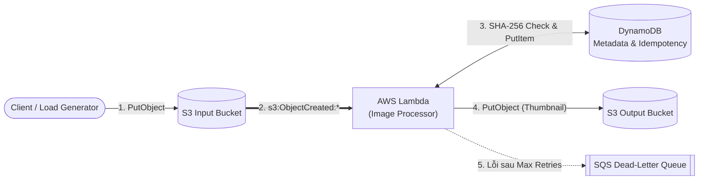

# Đề tài 9: Xây dựng hệ thống xử lý ảnh hướng sự kiện bằng Serverless và đánh giá Cold Start

Kho mã nguồn bài tập lớn học phần **Điện toán đám mây**. Dự án triển khai pipeline xử lý ảnh hướng sự kiện (Event-Driven Architecture) trên nền tảng FaaS (AWS Lambda / LocalStack), tích hợp cơ chế chống trùng lặp (**Idempotency**) với DynamoDB, cô lập sự kiện lỗi bằng hàng đợi **Dead-Letter Queue (SQS DLQ)**, phân quyền bảo mật tối thiểu (**IAM Least Privilege**) và đánh giá hiệu năng **Cold Start / Warm Invocation**.

---

## 👥 Danh sách thành viên & Phân công nhiệm vụ

| Thành viên | Mã sinh viên | Vai trò / Trách nhiệm | Hạng mục phụ trách | Tệp mã nguồn tương ứng |
| :--- | :---: | :--- | :--- | :--- |
| **Lê Doãn Đạt** | `038206000230` | **Kiến trúc sư Hạ tầng & DevOps**<br>*(Hạ tầng, Mạng, Bảo mật)* | • Khởi tạo Git repo, cấu hình `.gitignore`<br>• Viết mã IaC (Terraform) dựng S3, SQS (DLQ), DynamoDB, Lambda<br>• Thiết lập môi trường chạy Serverless (AWS & LocalStack)<br>• Cấu hình IAM Least Privilege<br>• Quản lý biến môi trường (không hardcode secret) | [`terraform/`](./terraform/)<br>[`docker-compose.yml`](./docker-compose.yml)<br>[`infrastructure/`](./infrastructure/)<br>[`docs/INFRASTRUCTURE_AND_SECURITY.md`](./docs/INFRASTRUCTURE_AND_SECURITY.md) |
| **Trần Ngọc Lâm** | `034206001749` | **Kỹ sư Phần mềm**<br>*(Mã nguồn, Xử lý ảnh, Idempotency)* | • Viết hàm Python (dùng Pillow) để resize ảnh và trích xuất metadata<br>• Lập trình tính Idempotency (kiểm tra hash SHA-256 chống trùng lặp)<br>• Bọc `try...except` bắt file hỏng/timeout<br>• Cấu hình retry và đẩy thông điệp lỗi ra DLQ | `src/lambda_function.py`<br>`requirements.txt` |
| **Vũ Thành Đạt** | `001206040720` | **Kỹ sư SRE & Kiểm thử**<br>*(Đo lường, Kịch bản lỗi, Runbook)* | • Tạo dataset 150 file (ảnh chuẩn, ảnh trùng, file lỗi)<br>• Viết kịch bản tự động tạo tải<br>• Chạy 4 thực nghiệm: Cold/Warm start, Idempotency, DLQ, Đánh đổi hiệu năng<br>• Đo lường p50, p95, throughput, tỷ lệ lỗi<br>• Viết sổ tay vận hành (Runbook) cho DLQ | `tests/test_suite_and_benchmark.py`<br>`docs/RUNBOOK_DLQ.md`<br>`data/metrics.csv` |

---

## 🏗️ Kiến trúc Hệ thống (Infrastructure as Code)



Chi tiết thiết kế hạ tầng, ma trận phân quyền **IAM Least Privilege** và lý thuyết bảo mật Serverless được trình bày tại:  
👉 **[Báo cáo Kiến trúc Hạ tầng & Bảo mật (`docs/INFRASTRUCTURE_AND_SECURITY.md`)](./docs/INFRASTRUCTURE_AND_SECURITY.md)**

---

## 📂 Cấu trúc Thư mục

```text
DTDM_XuLyAnh_Serverless/
├── .env.example                           # Mẫu biến môi trường (Zero hardcoded secrets)
├── .gitignore                             # Chặn file state, tfvars, secrets, build artifacts
├── Bảng phân công.xlsx                    # Bảng phân công nhiệm vụ của nhóm
├── docker-compose.yml                     # Khởi tạo môi trường giả lập AWS LocalStack
├── terraform/                             # Mã nguồn Infrastructure as Code (Phụ trách: Lê Doãn Đạt)
│   ├── main.tf                            # Cấu trúc tổng thể & Data sources
│   ├── providers.tf                       # Cấu hình AWS Provider (hỗ trợ AWS Cloud & LocalStack)
│   ├── variables.tf                       # Tham số hóa RAM, Timeout, DLQ, Bucket, Environment
│   ├── s3.tf                              # S3 Input/Output Buckets, AES-256 SSE, Event Trigger
│   ├── sqs.tf                             # Hàng đợi lỗi Dead-Letter Queue (SQS DLQ)
│   ├── dynamodb.tf                        # Bảng DynamoDB On-Demand lưu Metadata & Idempotency
│   ├── iam.tf                             # Chính sách phân quyền tối thiểu (IAM Least Privilege)
│   ├── lambda.tf                          # Cấu hình hàm Lambda, X-Ray Tracing, Env Vars & DLQ
│   ├── outputs.tf                         # Xuất ARN/URL/Tên tài nguyên bàn giao cho nhóm
│   └── terraform.tfvars.example           # Mẫu cấu hình biến Terraform
├── infrastructure/
│   ├── bootstrap/lambda_bootstrap.py      # Hàm giữ chỗ tự động khi chưa có src/lambda_function.py
│   └── scripts/
│       ├── deploy_local.sh                # Tự động dựng LocalStack + Terraform Apply
│       ├── deploy_aws.sh                  # Triển khai lên AWS Cloud thật
│       ├── destroy.sh                     # Dọn dẹp tài nguyên chống phát sinh chi phí
│       └── security_audit.py              # Script kiểm định IAM Least Privilege & quét Secret
├── docs/
│   └── INFRASTRUCTURE_AND_SECURITY.md     # Tài liệu thiết kế hạ tầng & minh chứng bảo mật
├── src/                                   # Thư mục mã nguồn xử lý ảnh (Phụ trách: Trần Ngọc Lâm)
└── tests/                                 # Thư mục kiểm thử & benchmark (Phụ trách: Vũ Thành Đạt)
```

---

## 🚀 Hướng dẫn Triển khai Hạ tầng & Kiểm định Bảo mật

### 1. Kiểm tra tính hợp lệ của Terraform (Validate)
```bash
cd terraform
terraform init -backend=false
terraform fmt -check
terraform validate
```

### 2. Chạy kiểm định Bảo mật & IAM Least Privilege
Chứng minh tự động không lưu khóa bí mật trong mã nguồn và kiểm tra chính sách phân quyền tối thiểu:
```bash
python3 infrastructure/scripts/security_audit.py
```

### 3. Triển khai môi trường giả lập LocalStack (Khuyên dùng khi phát triển & chấm bài)
```bash
./infrastructure/scripts/deploy_local.sh
```

### 4. Triển khai lên môi trường AWS Cloud thật
```bash
./infrastructure/scripts/deploy_aws.sh
```

### 5. Hủy hạ tầng sau khi thực nghiệm (Kiểm soát chi phí)
```bash
./infrastructure/scripts/destroy.sh
```
