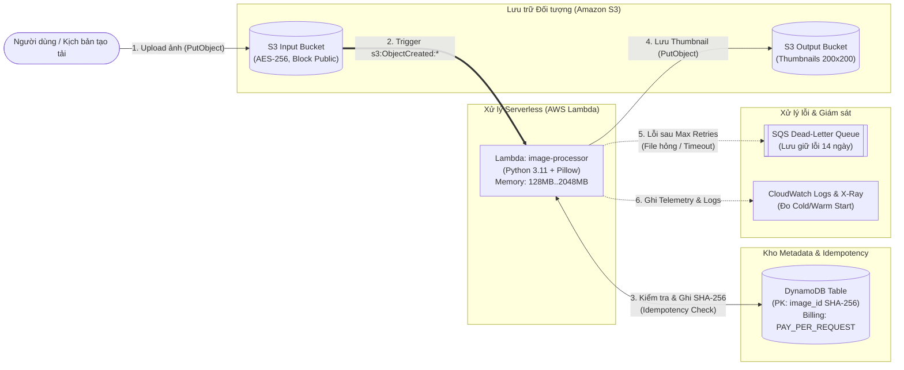

# Báo cáo Kiến trúc Hạ tầng, Mạng & Bảo mật (Đề tài 9)

**Thành viên phụ trách:** Lê Doãn Đạt - MSSV: `038206000230`  
**Vai trò:** Kiến trúc sư Hạ tầng & DevOps (Hạ tầng, Mạng, Bảo mật)  
**Đề tài 9:** Xây dựng hệ thống xử lý ảnh hướng sự kiện bằng Serverless và đánh giá Cold Start

---

## 1. Tổng quan Kiến trúc Hướng sự kiện (Event-Driven Serverless Pipeline)

### 1.1. Giải quyết câu hỏi nghiên cứu dưới góc độ Hạ tầng
> *"Khi tệp được tải lên theo các nhịp không đều, kiến trúc hướng sự kiện có thể tự động xử lý tin cậy và kiểm soát chi phí ra sao?"*

- **Đáp ứng nhịp tải không đều (Spiky / Unpredictable Workloads):** Toàn bộ các thành phần hạ tầng được thiết kế theo mô hình **Serverless 100%** (Amazon S3, AWS Lambda, Amazon DynamoDB On-Demand, Amazon SQS). Khi không có tệp tải lên, hệ thống tự động thu về mức tiêu thụ tài nguyên bằng `0` (Scale-to-Zero). Khi có đột biến hàng trăm tệp tải lên đồng thời, S3 phát sinh sự kiện bất đồng bộ kích hoạt các micro-container Lambda mở rộng tức thì.
- **Xử lý tin cậy (Reliability & Fault Tolerance):** Chuỗi sự kiện bất đồng bộ tích hợp cơ chế tự động thử lại (**Retry with Backoff**), kiểm soát trùng lặp (**Idempotency Store** trên DynamoDB) và cô lập thông điệp lỗi không thể phục hồi vào hàng đợi **Dead-Letter Queue (SQS DLQ)** với thời gian lưu trữ 14 ngày để đội ngũ SRE điều tra và phát lại (Replay).
- **Kiểm soát chi phí (Cost Control):**
  - **AWS Lambda:** Tính phí theo số lượt gọi và thời gian chạy thực tế tính bằng mili-giây ($\text{GB-giây}$).
  - **Amazon DynamoDB:** Cấu hình ở chế độ `PAY_PER_REQUEST` (On-Demand), không tốn phí duy trì Throughput cố định (Provisioned RCU/WCU).
  - **CloudWatch Logs:** Giới hạn vòng đời lưu trữ `retention_in_days = 14` ngày để tránh phình to chi phí lưu trữ log.

### 1.2. Sơ đồ Kiến trúc Hệ thống



---

## 2. Cơ sở Lý thuyết Hạ tầng & Bảo mật Serverless (Nội dung Báo cáo)

### 2.1. Mô hình thực thi FaaS, Event Source, Trigger & At-least-once Delivery
- **FaaS (Function-as-a-Service):** Đơn vị triển khai là hàm xử lý (`lambda_handler`). Nhà cung cấp đám mây quản lý hoàn toàn máy chủ vật lý, hệ điều hành và việc cấp phát container thực thi (Execution Environment).
- **Event Source & Trigger:** Nguồn phát sinh sự kiện là `aws_s3_bucket.input`. Khi có hành động tạo đối tượng mới (`s3:ObjectCreated:*`), cấu hình `aws_s3_bucket_notification` sẽ đóng vai trò **Trigger** gọi hàm Lambda ở chế độ **Asynchronous Invocation** (Gọi bất đồng bộ qua hàng đợi sự kiện nội bộ của Lambda).
- **Stateless Execution:** Mỗi lần thực thi hàm không lưu giữ trạng thái phiên làm việc trong bộ nhớ giữa các lần gọi khác nhau. Mọi trạng thái bền vững được ủy thác sang **Amazon DynamoDB** (`image_metadata`).
- **Timeout & Concurrency:**
  - `timeout` (mặc định `30s`): Ngưỡng thời gian tối đa cho phép một lần thực thi nhằm ngăn chặn các tiến trình bị treo làm thất thoát chi phí.
  - `concurrency`: Số lượng Execution Environments chạy song song tại cùng một thời điểm.
- **At-least-once Delivery & Idempotency:** Trong kiến trúc phân tán hướng sự kiện, S3/Lambda đảm bảo thông điệp được chuyển phát **ít nhất một lần (at-least-once)** — nghĩa là cùng một sự kiện tải ảnh có thể được gửi lặp lại do lỗi mạng hoặc cơ chế retry. Vì vậy, hạ tầng cung cấp bảng DynamoDB với khóa chính `image_id` (mã băm SHA-256) và chỉ mục `StatusIndex` để tầng ứng dụng đảm bảo tính **Idempotent** (xử lý $N$ lần cùng 1 sự kiện vẫn cho kết quả như 1 lần duy nhất).

### 2.2. Cold Start, Warm Invocation, Package Size & Provisioned Concurrency
- **Cold Start:** Xảy ra khi có sự kiện mới nhưng không có Execution Environment nào đang rảnh. Hạ tầng phải thực hiện chuỗi bước: *Khởi tạo MicroVM (Firecracker) $\rightarrow$ Tải mã nguồn gói `.zip` từ S3 nội bộ $\rightarrow$ Khởi động Python Runtime $\rightarrow$ Chạy mã khởi tạo ngoài hàm handler (`Init Duration`)*.
- **Warm Invocation:** Tái sử dụng Execution Environment đã được khởi tạo trước đó. Độ trễ giảm mạnh vì bỏ qua hoàn toàn pha `Init Duration`.
- **Ảnh hưởng của Memory Size & Package Size:**
  - Trong AWS Lambda, **CPU và băng thông mạng được cấp phát tỷ lệ thuận với `memory_size`**. Tăng `lambda_memory_size` (ví dụ từ `128MB` lên `512MB` hoặc `1024MB`) giúp tăng tốc độ giải nén gói thư viện Pillow và giảm mạnh thời gian xử lý ảnh (CPU-bound), đôi khi làm tổng chi phí ($\text{GB-s}$) thấp hơn hoặc tương đương nhưng độ trễ $p95$ tốt hơn vượt trội.
  - **Provisioned Concurrency:** Cơ chế giữ sẵn một số lượng môi trường thực thi luôn ở trạng thái "Warm" để triệt tiêu Cold Start cho các hệ thống yêu cầu SLA độ trễ nghiêm ngặt, đổi lại phát sinh chi phí duy trì nền.

### 2.3. Rủi ro Bảo mật Serverless & Giải pháp Khắc phục trong Đồ án

| Rủi ro bảo mật Serverless | Nguyên nhân phổ biến | Giải pháp Kiến trúc trong `terraform/` |
| :--- | :--- | :--- |
| **1. Quyền quá rộng (Over-privileged Function)** | Dùng `AdministratorAccess` hoặc `Action: "s3:*"`, `Resource: "*"` cho Lambda. Nếu hàm bị khai thác, kẻ tấn công chiếm toàn bộ Cloud. | Cấu hình **IAM Least Privilege** tách biệt từng câu lệnh trong [`terraform/iam.tf`](../terraform/iam.tf): chỉ được `GetObject` ở Input Bucket, chỉ được `PutObject` ở Output Bucket, không có quyền `DeleteObject` hay quản trị. |
| **2. Injection qua sự kiện (Event Data Injection)** | Tin tưởng tuyệt đối vào tên file (`object.key`) hoặc nội dung tệp giả mạo ảnh chứa mã độc làm tràn bộ nhớ/command injection. | Bật S3 Server-Side Encryption, không gọi shell command từ tên file, xác thực định dạng bằng thư viện `Pillow` và tính băm SHA-256. |
| **3. Lộ khóa bí mật (Hardcoded Secrets)** | Lưu trực tiếp `AWS_ACCESS_KEY_ID` và `AWS_SECRET_ACCESS_KEY` trong mã Python hoặc đẩy file `.env`, `.tfstate` lên Git. | Sử dụng **IAM Execution Role (STS Temporary Token)** tự động xoay vòng; cấu hình thông số qua biến môi trường (`environment`); chặn triệt để trong [`.gitignore`](../.gitignore) và kiểm tra tự động bằng [`security_audit.py`](../infrastructure/scripts/security_audit.py). |
| **4. Rò rỉ dữ liệu tạm (`/tmp` Data Leakage)** | Do cơ chế **Warm Invocation** tái sử dụng container, các tệp ảnh tạm ghi vào `/tmp` nếu không xóa sẽ tồn tại ở lần gọi kế tiếp. | Thiết kế xử lý ảnh trực tiếp trên luồng bộ nhớ (`io.BytesIO`) hoặc dọn dẹp `/tmp` trong khối `finally`. |

---

## 3. Chính sách IAM Tối thiểu (Least Privilege Matrix)

Tệp [`terraform/iam.tf`](../terraform/iam.tf) định nghĩa chính sách `aws_iam_policy.lambda_least_privilege` với bảng phân quyền chi tiết cho từng thành phần như sau:

| Thành phần đích | Statement ID (`Sid`) | Quyền được cấp (`Action`) | Phạm vi tài nguyên (`Resource`) | Quyền bị từ chối ngầm định (Implicit Deny) |
| :--- | :--- | :--- | :--- | :--- |
| **S3 Input Bucket** | `S3InputBucketReadOnly` | `s3:GetObject`, `s3:GetObjectTagging` | `${aws_s3_bucket.input.arn}/*` | Không được ghi đè (`PutObject`) hoặc xóa ảnh gốc (`DeleteObject`). |
| **S3 Output Bucket** | `S3OutputBucketWriteOnly` | `s3:PutObject`, `s3:PutObjectAcl` | `${aws_s3_bucket.output.arn}/*` | Không được xóa ảnh thumbnail của người dùng khác (`DeleteObject`). |
| **DynamoDB Metadata** | `DynamoDBIdempotencyAccess` | `dynamodb:GetItem`, `PutItem`, `UpdateItem`, `Query` | `${aws_dynamodb_table.image_metadata.arn}` & `/index/*` | Không được xóa bảng (`DeleteTable`) hoặc xóa bản ghi (`DeleteItem`). |
| **SQS Dead-Letter Queue** | `SQSDeadLetterQueueSendOnly` | `sqs:SendMessage`, `GetQueueAttributes`, `GetQueueUrl` | `${aws_sqs_queue.dlq.arn}` | Không được xóa hàng đợi (`DeleteQueue`) hay xóa thông điệp lỗi (`PurgeQueue`). |
| **CloudWatch Logs** | `CloudWatchLoggingPermissions` | `logs:CreateLogGroup`, `CreateLogStream`, `PutLogEvents` | Chỉ giới hạn trong `/aws/lambda/${var.project_name}-*` | Không được đọc hoặc xóa log của các dịch vụ khác. |

---

## 4. Bằng chứng Không lưu Khóa trong Mã nguồn (Zero Hardcoded Secrets)

Hệ thống cung cấp script kiểm định tự động [`infrastructure/scripts/security_audit.py`](../infrastructure/scripts/security_audit.py). Cách thức vận hành:

```bash
python3 infrastructure/scripts/security_audit.py
```

Kết quả thực thi:
1. **Quét Regex toàn bộ kho mã nguồn:** Kiểm tra các mẫu `AKIA...`, `ASIA...`, `aws_secret_access_key`, `PRIVATE KEY`, `password/api_token`.
2. **Kiểm tra `.gitignore`:** Đảm bảo các tệp nhạy cảm (`*.tfstate`, `*.tfvars`, `.env`, `*.pem`, `*.key`) bị loại trừ khỏi lịch sử Git.
3. **Kiểm tra tĩnh (Static Analysis) `terraform/iam.tf`:** Đảm bảo không tồn tại `AdministratorAccess` hoặc `Action = "*"`.

---

## 5. Hợp đồng Giao tiếp Hạ tầng (Bàn giao cho Nhóm)

Sau khi chạy Terraform (`deploy_local.sh` hoặc `deploy_aws.sh`), các biến môi trường sau được tự động tiêm vào hàm Lambda và xuất ra qua `terraform output` để 2 thành viên còn lại tích hợp:

| Tên Biến Môi Trường | Ý nghĩa | Người sử dụng |
| :--- | :--- | :--- |
| `ENVIRONMENT` | Môi trường đang chạy (`local`, `dev`, `prod`) | Trần Ngọc Lâm (`src/`) & Vũ Thành Đạt (`tests/`) |
| `INPUT_BUCKET` | Tên S3 Bucket chứa ảnh tải lên | Vũ Thành Đạt đẩy 150 ảnh test; Trần Ngọc Lâm đọc ảnh |
| `OUTPUT_BUCKET` | Tên S3 Bucket lưu ảnh thumbnail sau khi resize | Trần Ngọc Lâm ghi ảnh đã resize |
| `METADATA_TABLE` | Tên bảng DynamoDB lưu metadata và kiểm tra SHA-256 | Trần Ngọc Lâm kiểm tra Idempotency & ghi trạng thái |
| `DLQ_URL` | Đường dẫn hàng đợi SQS Dead-Letter Queue | Trần Ngọc Lâm đẩy lỗi / Vũ Thành Đạt viết Runbook DLQ |
| `MAX_RETRY_COUNT` | Số lần retry tối đa (mặc định: `3`) | Trần Ngọc Lâm & Vũ Thành Đạt |
| `THUMBNAIL_WIDTH` | Chiều rộng thumbnail (mặc định: `200`) | Trần Ngọc Lâm (`Pillow` resize) |
| `THUMBNAIL_HEIGHT` | Chiều cao thumbnail (mặc định: `200`) | Trần Ngọc Lâm (`Pillow` resize) |
| `LOG_LEVEL` | Cấp độ ghi log (`INFO`, `DEBUG`, `ERROR`) | Trần Ngọc Lâm |
